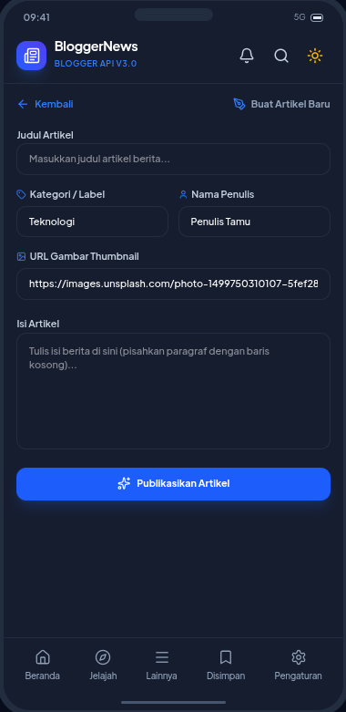
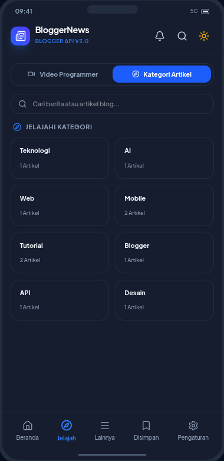
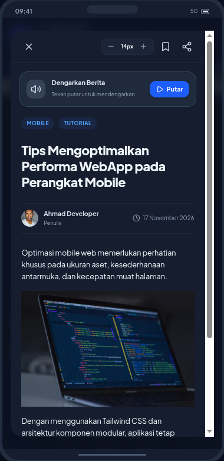
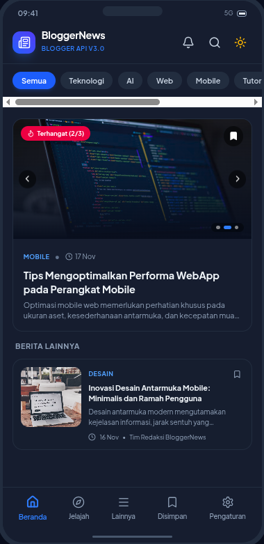
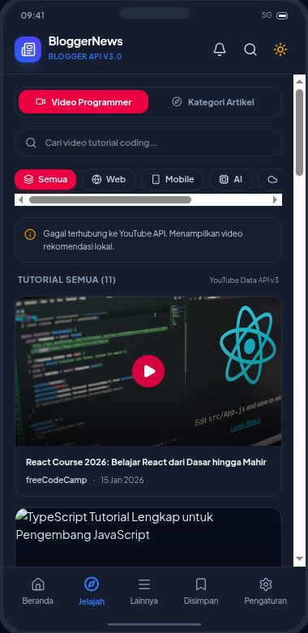
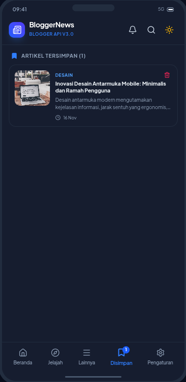
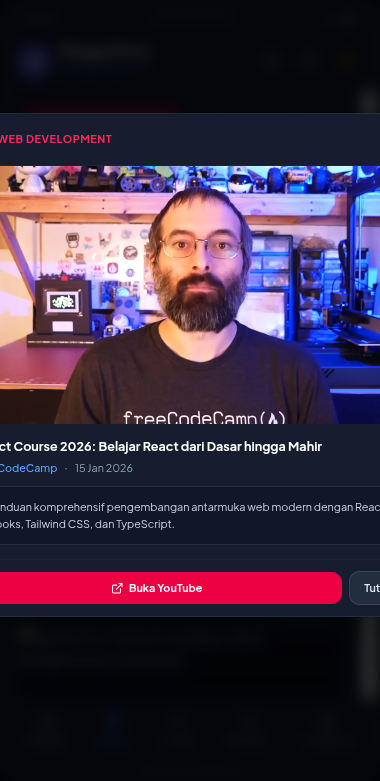

# BloggerNews Mobile

## Deskripsi
BloggerNews Mobile adalah aplikasi web berorientasi perangkat seluler untuk membaca artikel blog melalui Blogger JSON API v3. Pengguna dapat menjelajahi artikel berdasarkan kategori, mencari tulisan, membuka artikel dalam tampilan baca, dan menyimpan tulisan untuk dibaca kembali. Aplikasi juga menyediakan area untuk membuat tulisan lokal, membaca artikel dengan text-to-speech, serta menjelajahi video tutorial pemrograman dari YouTube.

Aplikasi menyediakan mode terang dan gelap, pengaturan Blog ID, serta kontrol izin notifikasi browser. Jika layanan API belum dikonfigurasi atau tidak dapat diakses, sebagian konten diganti dengan data fallback agar antarmuka tetap dapat dicoba.

## Integrasi Blogger dan YouTube API

- **Blogger JSON API v3:** Dengan Blog ID dan Google API key, aplikasi mengambil daftar artikel dari endpoint `blogs/{blogId}/posts` serta mencari artikel melalui `blogs/{blogId}/posts/search`. API juga digunakan untuk memuat komentar artikel. Data fallback lokal dipakai jika konfigurasi belum tersedia atau permintaan gagal. Tulisan yang dibuat dari form tetap disimpan lokal dan tidak dipublikasikan ke Blogger.
- **YouTube Data API v3:** Tab video mencari tutorial berdasarkan kata kunci dan topik, lalu menampilkan video yang dapat diputar lewat embed. Jika API key tidak tersedia, kuota habis, atau request gagal, aplikasi menampilkan data video fallback.

## Alur Penggunaan

1. Pengguna membaca artikel unggulan atau daftar berita di Beranda.
2. Pengguna dapat mencari artikel, memilih kategori, atau membuka detail tulisan.
3. Dari tampilan baca, pengguna dapat mengatur ukuran teks, mendengarkan isi artikel, membagikan tautan, atau menyimpan artikel.
4. Tab Jelajah menyediakan kategori artikel dan video tutorial programmer dengan filter topik serta pencarian.
5. Artikel yang dibuat melalui form disimpan sebagai tulisan lokal dalam aplikasi; fitur tersebut tidak menerbitkan tulisan ke akun Blogger.

## Screenshot Fitur

### 1. Formulir Buat Artikel

Formulir menerima judul, kategori/label, nama penulis, URL gambar thumbnail, dan isi artikel. Tombol publikasi menambahkan tulisan ke daftar lokal aplikasi dan dapat memicu notifikasi browser; tulisan tersebut bukan publikasi langsung ke Blogger.

### 2. Jelajah Kategori dan Pencarian Artikel

Tab Kategori Artikel menyediakan pencarian serta daftar kategori/label yang ditemukan pada artikel. Pengguna dapat memilih kategori untuk melihat tulisan terkait. Tab ini berbagi halaman Jelajah dengan bagian video programmer.

### 3. Tampilan Baca Artikel

Pembaca menampilkan isi artikel, label, informasi penulis, kontrol ukuran teks, tombol bookmark dan berbagi, serta pemutar text-to-speech. Pembacaan suara menggunakan fitur ucapan yang tersedia pada browser/perangkat.

### 4. Beranda dan Daftar Artikel

Beranda menampilkan filter kategori, carousel artikel unggulan, ringkasan berita lain, dan navigasi ke Jelajah, Lainnya, Disimpan, serta Pengaturan. Ikon di bagian atas menyediakan akses ke notifikasi dan pencarian.

### 5. Video Tutorial Programmer

Bagian Video Programmer menyediakan pencarian dan filter topik seperti Web, Mobile, AI, DevOps, dan Algoritma. Screenshot memperlihatkan pemberitahuan bahwa koneksi ke YouTube API gagal dan aplikasi sedang menampilkan rekomendasi lokal.

### 6. Artikel Tersimpan

Tab Disimpan menampilkan artikel yang telah di-bookmark dan menyediakan kontrol untuk menghapusnya. Daftar bookmark disimpan di `localStorage` browser sehingga tetap tersedia setelah halaman dimuat ulang pada browser yang sama.

### 7. Pemutar Video YouTube

Memilih kartu video membuka tampilan pemutar dan menyediakan tautan untuk membuka video di YouTube. Pemutaran bergantung pada ketersediaan video, jaringan, dan dukungan embed dari YouTube.

## Fitur Lain yang Tersedia

Fitur berikut ada di aplikasi, tetapi tidak tampak pada screenshot recap ini:

- **Komentar artikel:** Tampilan baca memuat komentar tulisan dari Blogger API. Daftar itu kosong bila API tidak mengembalikan komentar atau aplikasi sedang memakai artikel fallback.
- **Menu Lainnya:** Navigasi bawah memuat Beranda, Jelajah, Lainnya, Disimpan, dan Pengaturan. Tombol Lainnya membuka Tulis Artikel dan Panduan API. Tab Disimpan menampilkan jumlah tulisan yang di-bookmark.
- **Pencarian artikel:** Memakai pencarian Blogger API ketika layanan tersedia, dan pencarian lokal pada tulisan fallback ketika permintaan daring gagal.
- **Teks ke suara:** Memakai Web Speech API pada browser. Suara yang tersedia mengikuti dukungan browser dan perangkat.
- **Notifikasi:** Meminta izin notifikasi browser dan menyediakan tombol tes. Saat tulisan lokal ditambahkan atau tes dijalankan, aplikasi menampilkan notifikasi browser dan pemberitahuan di dalam halaman.
- **Pengaturan aplikasi:** Menyimpan Blog ID, OneSignal App ID, preferensi notifikasi, dan tema di browser.
- **Panduan API:** Menyediakan dua panduan di dalam aplikasi, untuk Blogger JSON API v3 dan YouTube Data API v3.
- **Cache video sesi:** Hasil pencarian YouTube disimpan di memori selama halaman belum dimuat ulang. Setelah dimuat ulang, aplikasi meminta data lagi atau kembali ke video fallback.

## Data dan Batasan

- Artikel Blogger dimuat melalui Blogger JSON API v3 menggunakan Blog ID dan Google API key yang dikonfigurasi. Jika permintaan gagal atau belum dikonfigurasi, aplikasi memakai artikel fallback yang tersimpan di source code.
- Screenshot artikel dan bookmark dapat menampilkan konten fallback/demo. Tampilan tersebut bukan bukti bahwa aplikasi sedang membaca blog Blogger tertentu atau bahwa nama penulis pada contoh merupakan identitas nyata.
- Tulisan dari form Buat Artikel dan bookmark disimpan di `localStorage` browser. Pembuatan tulisan tidak menggunakan endpoint publikasi Blogger atau autentikasi Blogger, sehingga tidak mengunggah artikel ke blog eksternal.
- Video dimuat melalui YouTube Data API v3 jika key tersedia. Bila key tidak tersedia, kuota habis, atau permintaan gagal, aplikasi menampilkan video fallback. Hasil video dan ketersediaan embed dapat berubah.
- Notifikasi yang dipicu aplikasi menggunakan izin dan API notifikasi browser. Pengiriman broadcast push dari server melalui OneSignal REST API belum tersedia.
- Text-to-speech bergantung pada dukungan browser/perangkat. Fitur bookmark dapat menyimpan data artikel secara lokal, tetapi gambar atau tautan eksternal tetap bergantung pada koneksi jaringan.
- Pengaturan, bookmark, dan tulisan lokal terikat pada penyimpanan browser/perangkat yang digunakan dan tidak otomatis disinkronkan ke perangkat lain.
