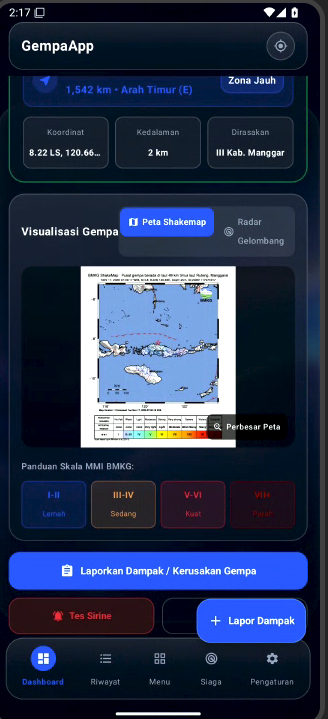
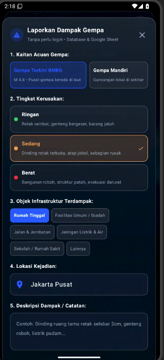
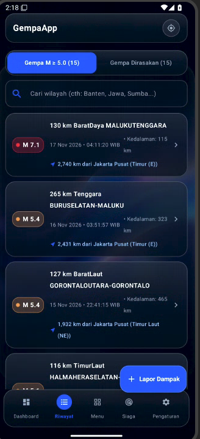
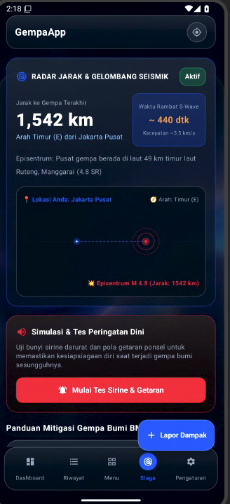

# GempaApp

## Deskripsi
GempaApp adalah aplikasi Android untuk melihat informasi gempa bumi dan prakiraan cuaca dari layanan BMKG. Aplikasi menampilkan gempa terkini, daftar gempa dengan magnitudo tertentu, gempa yang dirasakan, dan visualisasi shakemap. Pengguna dapat memakai lokasi GPS atau memilih lokasi acuan untuk melihat perkiraan jarak dan arah terhadap episentrum.

Aplikasi juga menyediakan prakiraan cuaca berdasarkan wilayah, formulir laporan dampak gempa, riwayat laporan lokal, panduan mitigasi, serta simulasi bunyi dan getaran. Sebagian fitur membutuhkan koneksi internet, izin lokasi, notifikasi, atau konfigurasi webhook sesuai penggunaannya.

## Fitur Utama

- **Pantauan gempa:** Mengambil data gempa otomatis, gempa terkini bermagnitudo minimal 5, dan daftar gempa yang dirasakan dari endpoint BMKG.
- **Visualisasi dan jarak:** Menampilkan shakemap atau radar, lokasi acuan, jarak, dan arah episentrum.
- **Riwayat gempa:** Menyediakan tab untuk gempa bermagnitudo minimal 5 dan gempa yang dirasakan, dengan pencarian wilayah.
- **Cuaca wilayah:** Menampilkan prakiraan cuaca BMKG per wilayah/kode ADM4 serta pilihan wilayah yang tersedia.
- **Laporan dampak:** Mencatat acuan gempa, tingkat kerusakan, infrastruktur terdampak, lokasi, deskripsi, dan foto bila dipilih.
- **Kesiapsiagaan:** Menyediakan panduan mitigasi, kalkulasi perkiraan rambat gelombang S, serta tes manual bunyi dan getaran.

## Integrasi API BMKG

GempaApp mengambil data gempa otomatis, daftar gempa terkini, dan gempa yang dirasakan dari endpoint JSON BMKG (`autogempa.json`, `gempaterkini.json`, dan `gempadirasakan.json`). Prakiraan cuaca diambil dari API publik BMKG berdasarkan kode wilayah ADM4. Data gempa disimpan sebagai cache lokal agar informasi terakhir yang berhasil dimuat masih dapat ditampilkan saat offline; cache tersebut mungkin bukan data terbaru. Integrasi ini adalah contoh penggunaan API BMKG, bukan layanan peringatan dini resmi.

## Alur Singkat

1. Aplikasi memuat data gempa dan cuaca dari BMKG, lalu memperbaruinya secara berkala jika auto-refresh aktif.
2. Pengguna memeriksa ringkasan gempa, membuka riwayat, atau memilih kejadian untuk melihat detail.
3. Pengguna dapat memilih lokasi acuan atau meminta lokasi GPS untuk menghitung jarak dan arah relatif.
4. Jika terdampak, pengguna dapat mengisi laporan yang disimpan di perangkat; sinkronisasi ke Google Sheets tersedia bila webhook dikonfigurasi.
5. Tab Siaga menyediakan panduan keselamatan dan kontrol simulasi sirine/getaran yang dipicu secara manual.

## Screenshot Fitur

### 1. Dashboard dan Visualisasi Gempa

Dashboard menampilkan ringkasan kejadian gempa, informasi lokasi dan jarak acuan, visualisasi shakemap atau radar, serta skala intensitas MMI. Tombol pada layar membuka formulir laporan dampak atau menjalankan tes sirine. Nilai pada gambar menggambarkan data saat screenshot diambil dan bukan pembaruan langsung yang dijamin.

### 2. Formulir Laporan Dampak

Formulir memungkinkan pengguna mengaitkan laporan dengan gempa BMKG terkini atau memilih laporan gempa mandiri, menentukan tingkat kerusakan dan jenis infrastruktur, serta mengisi lokasi dan deskripsi. Formulir dapat digunakan tanpa login. Screenshot menunjukkan formulir, bukan bukti bahwa laporan sudah terkirim.

### 3. Riwayat Gempa

Riwayat menyediakan tab gempa bermagnitudo minimal 5 dan gempa yang dirasakan, kolom pencarian wilayah, serta kartu berisi magnitudo, waktu, kedalaman, lokasi, dan jarak/arah relatif terhadap lokasi acuan.

### 4. Tab Siaga dan Radar Episentrum

Tab Siaga memvisualisasikan hubungan lokasi pengguna dengan episentrum, menampilkan perkiraan waktu rambat gelombang S, dan menyediakan tombol tes sirine serta getaran. Perhitungan waktu menggunakan perkiraan kecepatan tetap; ini bukan prediksi waktu kedatangan yang presisi atau layanan peringatan dini resmi. Panduan mitigasi tersedia pada bagian bawah layar.

## Fitur Lain yang Tersedia

Fitur berikut terimplementasi tetapi belum memiliki screenshot pada recap ini:

- **Pusat menu:** Satu layar mengumpulkan laporan dampak, prakiraan cuaca, tes sirine, jalan pintas ke tab Siaga, dan pengaturan.
- **Panggilan darurat:** Menu menyediakan tombol panggilan ke BNPB (117), Basarnas (115), ambulans (118), dan polisi (110). Tombol membuka aplikasi telepon perangkat.
- **Detail kejadian:** Memilih satu gempa membuka rincian magnitudo, kedalaman, wilayah, jarak, dan arah dari lokasi acuan. Dari sana pengguna dapat membagikan ringkasan teks atau membuka formulir laporan.
- **Prakiraan cuaca:** Memilih wilayah yang sudah disediakan atau memasukkan kode wilayah ADM4. Hasil BMKG ditampilkan per jam.
- **Riwayat laporan dampak:** Melihat dan menyaring laporan tersimpan menurut tingkat kerusakan. Laporan, termasuk foto bila dipilih, disimpan di database lokal Room.
- **Pengaturan:** Mengubah tema terang, gelap, atau mengikuti sistem, mengaktifkan atau menjeda auto-refresh, mengelola webhook Google Sheets, dan membuka riwayat laporan.
- **Lokasi GPS:** Meminta izin lokasi Android, mengambil koordinat, dan melakukan reverse geocoding untuk menampilkan nama wilayah.
- **Notifikasi uji:** Tes sirine mengirim notifikasi Android untuk gempa yang sedang diuji, bersama getaran dan bunyi. Notifikasi itu bagian dari simulasi yang dimulai pengguna, bukan peringatan otomatis dari BMKG.
- **Cache gempa:** Menyimpan data gempa di database lokal agar data terakhir yang pernah dimuat dapat ditampilkan saat jaringan tidak tersedia. Data cache dapat lebih lama daripada data BMKG terbaru.
- **Build APK:** GitHub Actions dapat membangun APK debug dan mengunggahnya sebagai artifact workflow.

## Data dan Batasan

- Data gempa dan prakiraan cuaca diambil dari endpoint publik BMKG. Informasi pada layar bergantung pada ketersediaan jaringan dan layanan sumber; selalu rujuk kanal resmi BMKG untuk informasi darurat terbaru.
- Auto-refresh berjalan berkala setiap 60 detik saat aktif, bukan aliran data tanpa jeda. Kegagalan jaringan dapat membuat data yang tampil berasal dari cache lokal.
- Laporan disimpan lokal di perangkat. Pengiriman ke Google Sheets hanya dicoba jika pengguna mengatur URL webhook; status sinkronisasi ditampilkan terpisah dari status penyimpanan lokal.
- Perhitungan jarak, arah, dan waktu rambat gelombang merupakan estimasi aplikasi. Tes sirine/getaran adalah simulasi yang harus dimulai pengguna, bukan penerimaan peringatan otomatis dari BMKG.
- Aplikasi bukan pengganti instruksi resmi BMKG, BPBD, atau layanan darurat. Jangan mengandalkannya sebagai satu-satunya sumber keputusan saat bencana.
- Fitur GPS memerlukan izin lokasi. Pembaruan notifikasi pada Android 13 ke atas juga memerlukan izin notifikasi.
- Laporan dapat memuat lokasi, deskripsi, dan foto dampak. Hindari memasukkan informasi pribadi yang tidak diperlukan saat membuat atau membagikan laporan.
