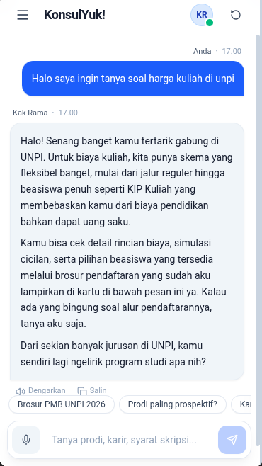
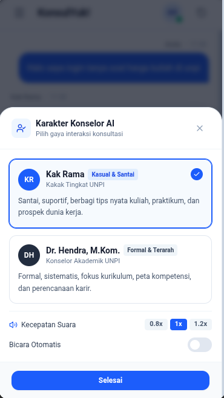
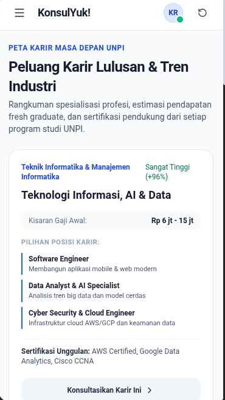
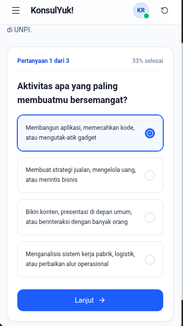
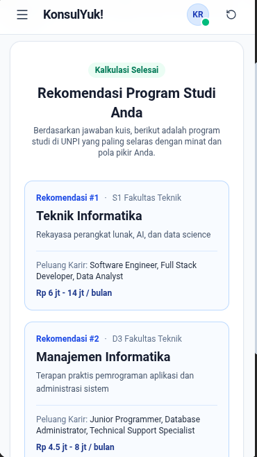

# KonsulYuk! UNPI

## Deskripsi
KonsulYuk! UNPI adalah aplikasi konsultasi berbasis web untuk mahasiswa dan calon mahasiswa Universitas Putra Indonesia (UNPI). Pengguna dapat bertanya melalui chat mengenai program studi, kehidupan akademik, penerimaan mahasiswa baru, dan pilihan karier. Jawaban chat dibuat oleh layanan AI di backend dengan konteks pengetahuan UNPI dan dokumen yang tersedia di aplikasi.

Aplikasi menyediakan dua persona konsultasi, eksplorasi program studi, peta karier, kuis minat tiga pertanyaan, serta interaksi suara berbasis fitur ucapan browser. Area admin menyediakan pengelolaan dokumen pengetahuan dan pemantauan proses AI. Riwayat chat disimpan di penyimpanan lokal browser.

## Fitur Utama

- **Chat konsultasi:** Mengirim pertanyaan ke backend Gemini dan menampilkan balasan, indikator proses, serta lampiran yang terkait dengan basis pengetahuan.
- **Persona konsultasi:** Memilih gaya jawaban kasual sebagai kakak tingkat atau gaya yang lebih formal untuk konsultasi akademik.
- **Eksplorasi prodi dan karier:** Menelusuri program studi, kompetensi, bidang pekerjaan, dan informasi karier yang disediakan aplikasi.
- **Kuis minat:** Mencocokkan jawaban dari tiga pertanyaan dengan program studi pada dataset aplikasi dan menampilkan dua rekomendasi teratas.
- **Voice chat:** Mengubah ucapan menjadi teks dan membacakan jawaban menggunakan Web Speech API pada browser yang mendukungnya.
- **Administrasi knowledge base:** Mengunggah dan mengelola dokumen, melihat analisis perubahan atau konflik informasi, dan memeriksa log generasi AI.

## Integrasi Chatbot Gemini API

Chat konsultasi mengirim permintaan dari frontend ke endpoint backend `/api/chat`, lalu backend menggunakan Google Gemini API melalui SDK `@google/genai` untuk menghasilkan jawaban. Instruksi persona, konteks informasi UNPI, riwayat percakapan terbaru, dan dokumen knowledge base dapat digunakan sebagai konteks jawaban. Kunci `GEMINI_API_KEY` dibaca oleh server dari environment, bukan dimasukkan ke antarmuka browser. Gemini juga dipakai pada alur admin untuk membantu mengekstrak atau membandingkan isi dokumen yang diunggah.

## Alur Penggunaan

1. Pengguna membuka tab Konsultasi dan memilih salah satu pertanyaan cepat atau menulis pertanyaan sendiri.
2. Pengguna dapat mengganti persona agar gaya konsultasi sesuai kebutuhan.
3. Backend mengirim pertanyaan dan sebagian riwayat percakapan ke layanan AI, lalu aplikasi menampilkan jawaban dan lampiran yang tersedia.
4. Untuk kuis minat, pengguna menjawab tiga pertanyaan. Aplikasi menghitung kecocokan berdasarkan prodi sasaran di setiap jawaban dan menampilkan dua rekomendasi teratas.
5. Hasil kuis, program studi, atau topik karier dapat diteruskan ke chat untuk dibahas lebih lanjut.

## Screenshot Fitur

### 1. Chat Konsultasi

Contoh ini memperlihatkan pertanyaan tentang biaya kuliah, jawaban asisten yang merujuk informasi pendaftaran, saran untuk mengeksplorasi program studi, serta kolom untuk mengirim pertanyaan lanjutan. Isi jawaban pada contoh tidak dengan sendirinya membuktikan bahwa informasi biaya atau beasiswa sudah diverifikasi.

### 2. Pemilihan Persona dan Pengaturan Suara

Pengguna dapat memilih persona dengan gaya percakapan berbeda, mengatur kecepatan suara, dan mengaktifkan atau menonaktifkan pembacaan otomatis. Voice chat dan pengenalan ucapan memerlukan izin mikrofon serta dukungan browser.

### 3. Peta Karier

Peta karier menghubungkan kelompok program studi dengan contoh posisi kerja, kompetensi, sertifikasi, dan kisaran pendapatan awal. Angka dan indikator pada layar merupakan informasi yang disediakan aplikasi, bukan jaminan gaji atau hasil penempatan kerja.

### 4a. Pertanyaan Kuis Minat

Kuis menampilkan satu pertanyaan pada satu waktu, pilihan jawaban, indikator kemajuan, dan tombol untuk melanjutkan. Pertanyaan pada gambar mengelompokkan minat berdasarkan aktivitas yang disukai pengguna.

### 4b. Rekomendasi Program Studi

Setelah kuis selesai, aplikasi menampilkan dua program studi dengan ringkasan bidang, pilihan karier, dan kisaran pendapatan yang tercatat pada dataset. Tombol pada halaman dapat membawa hasil rekomendasi ke chat AI. Hasil ini merupakan pencocokan sederhana, bukan asesmen psikologi atau keputusan penerimaan mahasiswa.

## Fitur Lain yang Terdokumentasi

Fitur berikut tercatat di dokumentasi aplikasi tetapi belum memiliki screenshot pada recap ini:

- **Persona bernama:** Antarmuka memakai dua persona, Kak Rama untuk gaya kakak tingkat dan Dr. Hendra untuk gaya konsultasi akademik. Keduanya mengatur gaya jawaban, bukan dua orang yang sedang menjawab secara langsung.
- **Tampilan jawaban:** Balasan chat disusun sebagai markdown. Saat jawaban disusun, aplikasi menampilkan indikator beberapa tahap. Jika basis pengetahuan punya lampiran yang cocok, lampiran itu dapat diunduh dari percakapan.
- **Eksplorasi program studi:** Dataset aplikasi memuat tujuh program studi. Pengguna dapat menyaring menurut fakultas dan mencari menurut nama, kompetensi, atau karier, lalu mengirim program studi yang dipilih ke chat.
- **Admin knowledge base:** Area admin dikunci dengan PIN yang dibaca server dari environment. Di dalamnya admin mengunggah dokumen atau brosur, mengelola dokumen aktif, dan melihat ringkasan perbedaan serta kemungkinan konflik dengan dokumen sebelumnya.
- **Log dan pemeriksaan AI:** Admin dapat melihat model, durasi, dokumen yang cocok, dan status fallback pada proses generasi, serta menjalankan pemeriksaan kasus respons. Log itu memakai buffer memori, bukan arsip permanen.
- **Antarmuka mobile:** Navigasi drawer, tab bawah untuk konsultasi, prodi, karier, dan kuis, pemilih persona, serta kontrol untuk memulai chat baru.

## Data dan Batasan

- Layanan chat memerlukan koneksi backend dan konfigurasi `GEMINI_API_KEY` di environment server. Kunci API tidak diperlukan atau ditampilkan di browser.
- Data program studi, karier, dan pertanyaan kuis disimpan sebagai dataset di aplikasi. Brosur PMB bawaan juga diinisialisasi sebagai data seed pada server; dokumen yang diunggah admin disimpan pada direktori lokal dan metadata basis pengetahuannya menggunakan berkas JSON.
- Informasi biaya kuliah, beasiswa, akreditasi, program studi, kisaran gaji, dan prospek karier perlu diperiksa kembali ke kanal resmi UNPI sebelum dijadikan dasar keputusan. Konten seed atau hasil AI dapat tidak mutakhir atau tidak terverifikasi.
- Kuis memakai pencocokan skor sederhana dari pilihan jawaban. Rekomendasinya bersifat informatif dan tidak menggantikan konsultasi akademik langsung.
- Pengenalan dan sintesis ucapan menggunakan Web Speech API. Ketersediaan fitur bergantung pada browser dan izin mikrofon; kode aplikasi menyarankan Chrome atau Edge bila pengenalan ucapan tidak didukung.
- Riwayat chat tersimpan di `localStorage` browser. Log generasi yang ditampilkan admin menggunakan buffer dalam memori sehingga tidak berfungsi sebagai arsip permanen.
- Aplikasi adalah alat konsultasi pendukung, bukan kanal keputusan resmi universitas. Hindari mengirim data pribadi atau informasi sensitif melalui chat.

Rincian implementasi dan cara pemeriksaan fitur tersedia di [`apps/konsulyuk!-unpii/docs/FEATURES.md`](../../apps/konsulyuk!-unpii/docs/FEATURES.md).
