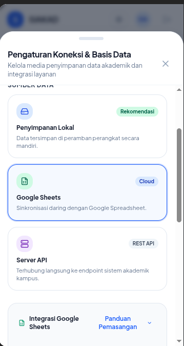
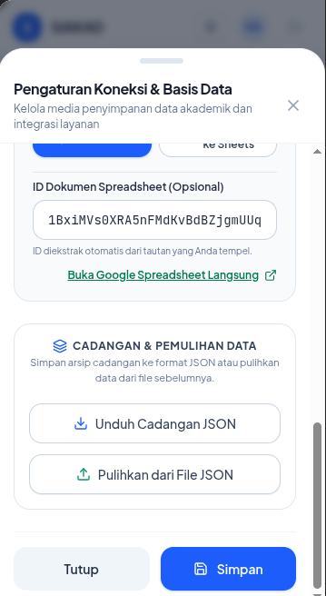
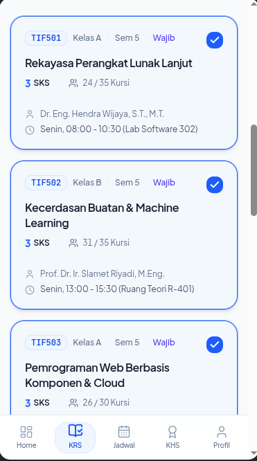
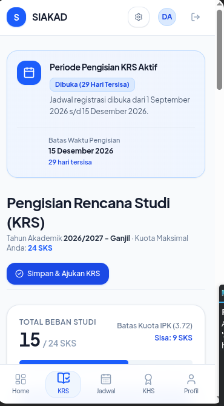
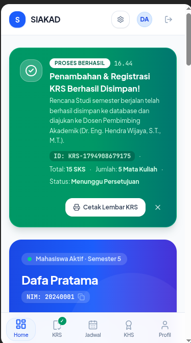
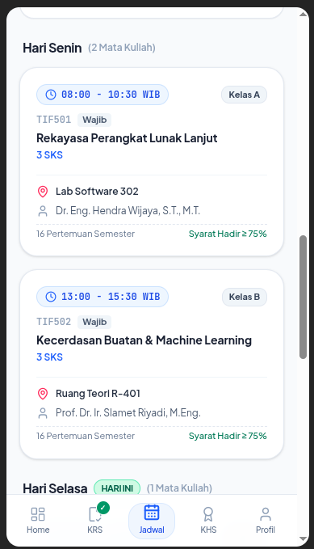
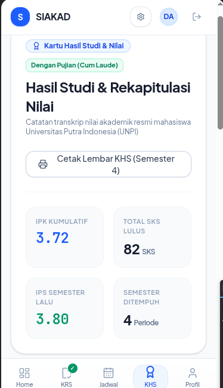

# KRS Mahasiswa

## Deskripsi
SIAKAD Mahasiswa UNPI adalah portal web untuk membantu mahasiswa mengelola kegiatan akademik. Portal ini merangkum informasi studi dan menyediakan akses ke beberapa bagian, termasuk pengisian Kartu Rencana Studi (KRS), jadwal perkuliahan, Kartu Hasil Studi (KHS), riwayat studi, dan profil.

Pada alur KRS, mahasiswa dapat melihat periode pengisian dan batas waktunya, meninjau mata kuliah beserta kelas, dosen, beban Satuan Kredit Semester (SKS), dan jadwal, lalu menyimpan serta mengajukan rencana studi. Antarmuka juga menampilkan ringkasan total SKS dan status pengajuan. Halaman jadwal menyusun perkuliahan menurut hari, sedangkan halaman KHS merangkum nilai dan capaian studi seperti IPK serta jumlah SKS lulus.

## Integrasi Database Google Apps Script

Portal menyediakan integrasi database Google Sheets melalui Google Apps Script Web App. Skrip `doGet`/`doPost` mengelola lima worksheet: Mahasiswa, TahunAkademik, MataKuliah, KRS, dan KRSDetail. Sinkronisasi dapat mengirim pengajuan KRS ke Google Sheets dan menyediakan aksi untuk membaca data atau menguji koneksi. Pengguna juga dapat mengunduh cadangan JSON dan memulihkan data.

Pada implementasi SIAKAD yang tersedia di repository, `localStorage` browser tetap menjadi penyimpanan awal (*default*); sinkronisasi jarak jauh memerlukan URL Apps Script dan konfigurasi penyedia Google Sheets. Jadi, Google Apps Script merupakan jalur integrasi database yang disediakan, bukan berarti semua data pada setiap instalasi otomatis tersimpan di spreadsheet. Skrip contohnya tersedia di [`apps/siakad-student-unpi/src/services/appsScriptSnippet.ts`](../../apps/siakad-student-unpi/src/services/appsScriptSnippet.ts), dengan rincian arsitektur di [`apps/siakad-student-unpi/docs/implementation/storage-strategy.md`](../../apps/siakad-student-unpi/docs/implementation/storage-strategy.md).

Aplikasi dapat memulai dengan data contoh; karena itu, nilai yang tampak pada screenshot tidak selalu mewakili data akademik resmi atau akun nyata.

## Screenshot Fitur

### 1. Integrasi Database dan Spreadsheet

Pengguna dapat memilih sumber penyimpanan data akademik, termasuk penyimpanan lokal, Google Sheets, atau Server API. Layar ini juga menyediakan panduan integrasi Google Sheets.

### 2. Ekspor, Impor, dan Pemulihan Data

Pengguna dapat menghubungkan spreadsheet dan mengelola cadangan data dengan mengunduh atau memulihkan berkas JSON.

### 3. Pengisian dan Pengajuan KRS
#### 3a. Daftar Mata Kuliah

Layar KRS menampilkan mata kuliah, kelas, semester, status wajib, beban SKS, kapasitas, dosen, dan jadwal. Bilah bawah menunjukkan navigasi utama aplikasi.

#### 3b. Konfirmasi Pengajuan KRS

Pesan konfirmasi menampilkan bahwa KRS berhasil disimpan dan diajukan, beserta ID KRS, jumlah mata kuliah, total SKS, status persetujuan, dan tombol cetak lembar KRS.

#### 3c. Periode Pengisian dan Beban Studi

Halaman ini menunjukkan periode pengisian KRS yang aktif, batas waktu pengisian, tahun akademik, batas maksimal SKS, total beban studi, dan sisa kuota.

### 4. Jadwal Perkuliahan

Jadwal disusun per hari dan menampilkan waktu kuliah, kelas, kode serta nama mata kuliah, lokasi, dosen, dan syarat kehadiran.

### 5. Kartu Hasil Studi

Halaman KHS menampilkan ringkasan hasil studi, termasuk IPK kumulatif, total SKS lulus, IPS semester lalu, semester yang telah ditempuh, dan tombol cetak lembar KHS.

## Fitur Lain yang Tersedia

Fitur berikut ada pada portal SIAKAD di repository, tetapi belum memiliki screenshot pada recap ini. Nilai dan identitas yang tampil berasal dari data demo, bukan rekaman akademik resmi.

- **Masuk portal:** Halaman masuk membuka data mahasiswa dari sumber penyimpanan yang sedang dipakai, dengan NIM sebagai kunci pencarian.
- **Dasbor:** Setelah masuk, dasbor merangkum identitas mahasiswa, dosen pembimbing akademik, IPK, IPS, batas SKS, dan sisa kuota. Ada grafik tren IPS antar semester, pratinjau jadwal, dan pintasan ke pengisian KRS atau cetak lembar.
- **Batas SKS menurut IPK:** Portal menghitung batas beban dari IPK yang tersimpan: 24 SKS bila IPK minimal 3,00, 21 SKS bila minimal 2,50, 18 SKS bila minimal 2,00, dan 15 SKS di bawah itu. Mata kuliah yang membuat total melewati batas ditolak, baik di layar maupun saat penyimpanan.
- **Pemeriksaan kelas:** Daftar KRS dapat disaring menjadi semua, wajib, atau pilihan. Kelas yang kuotanya penuh tidak bisa dipilih. Bila dua mata kuliah terpilih jatuh pada hari dan jam mulai yang sama, kartu menampilkan peringatan bentrok.
- **Status pengajuan:** Menyimpan KRS mengubah status menjadi menunggu persetujuan. Data demo juga memuat KRS berstatus disetujui. Portal mahasiswa ini tidak menyediakan layar dosen untuk menolak pengajuan.
- **Jadwal dari KRS:** Jadwal mingguan terbentuk dari mata kuliah pada KRS semester berjalan. Layar menyorot kuliah hari ini, dapat mencari menurut nama, kode, dosen, atau jadwal, dan dapat mencetak salinan mingguan. Sebelum ada KRS, jadwal kosong.
- **Nilai dan arsip:** Halaman KHS dapat berpindah antar semester, menampilkan nilai angka, huruf mutu, bobot, dan persentase kehadiran. Kehadiran di bawah 75% ditandai pada tabel. IPK juga dipetakan ke predikat kelulusan. Tab lain menampilkan transkrip kumulatif dan arsip rencana studi semester lampau. Lembar KHS dapat dicetak.
- **Profil:** Halaman profil menampilkan program studi, fakultas, semester, angkatan, dosen pembimbing, IPK, tabel batas SKS, dan tombol keluar.
