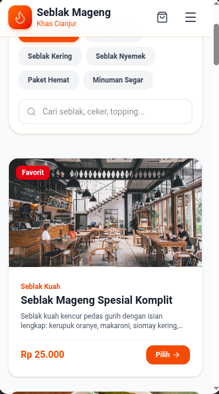
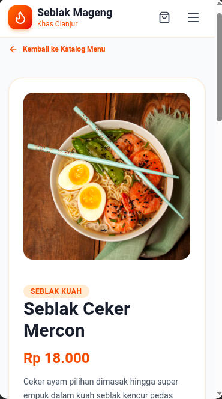
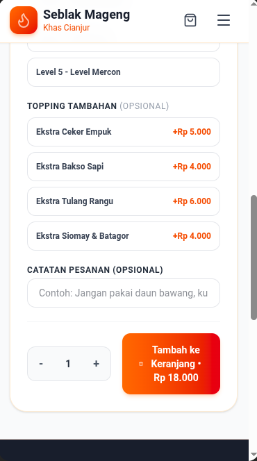
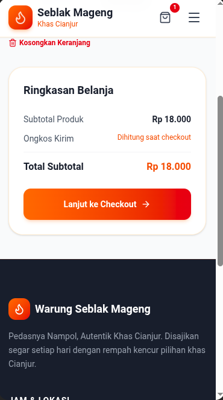
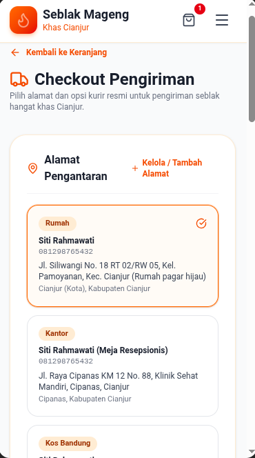
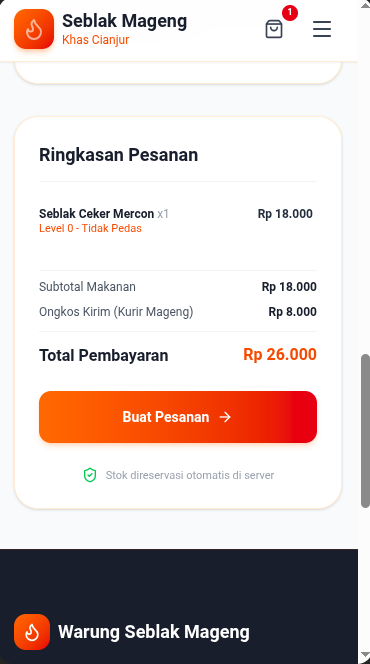
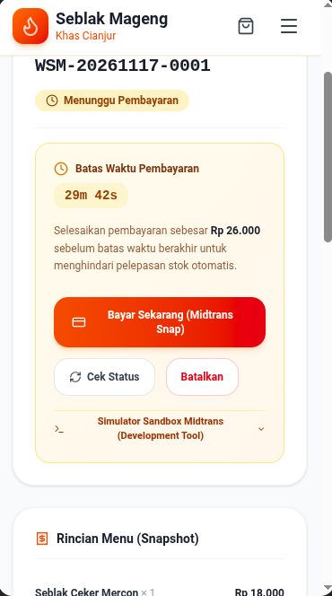
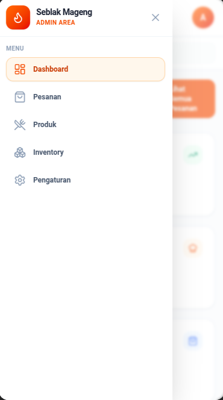
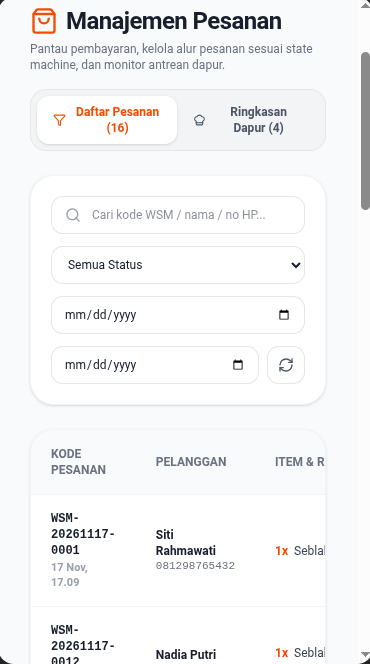

# Warung Seblak Mageng

## Deskripsi
Warung Seblak Mageng adalah prototipe toko online untuk usaha seblak di Cianjur. Aplikasi menyediakan katalog menu yang dapat dicari dan disaring berdasarkan kategori. Pelanggan dapat membuka detail produk, menentukan tingkat pedas dan topping, menambahkan catatan, lalu melanjutkan pesanan melalui keranjang dan checkout.

Pada tahap checkout, pelanggan memilih alamat dan layanan pengiriman, kemudian meninjau ringkasan biaya sebelum membuat pesanan. Aplikasi juga mencakup akun pelanggan, riwayat pesanan, serta halaman admin untuk mengelola produk, persediaan, dan pemrosesan pesanan. Sistem backend memvalidasi harga dan stok serta mengelola reservasi stok selama pesanan menunggu pembayaran.

Proyek ini merupakan prototipe full-stack untuk latihan dan portofolio, bukan layanan produksi. Integrasi penyimpanan dan layanan eksternal masih memiliki batasan; statusnya dijelaskan pada bagian [Status dan Batasan](#status-dan-batasan).

## Alur Pemesanan

1. Pelanggan mencari menu melalui katalog dan membuka detail produk.
2. Pelanggan memilih tingkat pedas, topping, jumlah porsi, dan catatan jika diperlukan.
3. Produk dimasukkan ke keranjang untuk ditinjau sebelum checkout.
4. Pelanggan memilih alamat dan opsi pengiriman, lalu memeriksa subtotal, ongkir, dan total.
5. Setelah pesanan dibuat, stok terkait direservasi sementara. Pesanan menunggu pembayaran dan mengikuti batas waktu pembayaran yang ditampilkan.
6. Admin memantau pesanan dan memproses tahap berikutnya melalui area admin.

## Screenshot Fitur

### 1. Katalog Menu

Katalog menampilkan pilihan kategori, kolom pencarian, dan kartu menu yang memuat foto, nama, deskripsi singkat, harga, serta tombol untuk membuka produk.

### 2. Detail Produk

Halaman detail menyajikan foto, kategori, nama, harga, dan uraian produk sebelum pelanggan menentukan opsi pesanannya.

### 3. Pilihan Produk dan Tambah ke Keranjang

Pelanggan dapat memilih tingkat pedas, menambah topping opsional, menuliskan catatan, dan menentukan jumlah porsi. Harga tombol mengikuti pilihan yang ditampilkan.

### 4. Ringkasan Keranjang

Keranjang merangkum subtotal produk. Ongkos kirim belum dimasukkan pada layar ini dan dihitung pada tahap checkout; pelanggan dapat melanjutkan ke pemilihan alamat dan layanan pengiriman.

### 5. Pemilihan Alamat Pengiriman

Layar checkout menampilkan alamat tersimpan untuk dipilih sebagai tujuan pengiriman dan menyediakan akses untuk mengelola atau menambahkan alamat. Data kontak dan alamat pada gambar merupakan informasi personal dan tidak disalin ke dalam keterangan.

### 6. Ringkasan dan Pembuatan Pesanan

Sebelum membuat pesanan, pelanggan dapat memeriksa rincian produk, ongkos kirim, dan total pembayaran. Antarmuka juga menyatakan bahwa stok akan direservasi oleh server. Nilai yang tampak pada gambar adalah contoh tampilan, bukan tarif yang dijamin berlaku.

### 7. Pembayaran Pesanan

Halaman detail menampilkan status menunggu pembayaran, batas waktu, jumlah yang harus dibayar, serta kontrol untuk membayar, memeriksa status, atau membatalkan pesanan. Terdapat juga simulator sandbox Midtrans untuk pengembangan; tampilannya tidak membuktikan bahwa pembayaran produksi telah dikonfigurasi.

### 8. Navigasi Area Admin

Drawer admin menyediakan akses ke dashboard, pesanan, produk, inventory, dan pengaturan toko. Area ini ditujukan untuk pengguna dengan peran admin.

### 9. Manajemen Pesanan Admin

Halaman manajemen pesanan menyediakan tab daftar pesanan dan ringkasan dapur, serta kontrol pencarian dan filter status atau tanggal. Gambar menampilkan data pelanggan; samarkan nama, nomor telepon, alamat, dan kode pesanan sebelum dokumen dipublikasikan.

## Fitur Lain yang Terdokumentasi

Selain layar pada screenshot, implementasi mencatat fitur berikut:

- **Beranda toko:** Halaman awal memuat perkenalan warung, menu unggulan, langkah pemesanan, jam buka, area layanan, dan kontak. Akun pelanggan dan admin dipisah lewat registrasi dan login.
- **Stok pada katalog:** Kartu menu menandai produk yang stok tersedianya habis dan tidak bisa ditambahkan ke keranjang. Admin melihat stok on hand, stok terreservasi, dan stok tersedia, plus penanda stok menipis menurut ambang batas. Penyesuaian stok meminta alasan dan tercatat di riwayat pergerakan.
- **Keranjang:** Pelanggan dapat mengubah jumlah, menghapus item, atau mengosongkan keranjang. Jumlah item tampil pada header. Sebelum pesanan dibuat, server menghitung ulang harga dan memeriksa stok.
- **Alamat dan mode kirim:** Alamat disusun bertingkat dari provinsi sampai kelurahan, dapat dijadikan alamat bawaan, dan punya panjang minimum. Produk basah dibatasi ke layanan instan lokal Cianjur. Produk kering dapat memakai opsi ekspres. Tarif yang tampil pada prototipe ini tetap simulasi.
- **Pesanan pelanggan:** Server membuat nomor pesanan, menyimpan snapshot nama, harga, opsi, dan alamat, lalu mereservasi stok. Pelanggan melihat riwayat dan detail pesanan. Pesanan yang melewati batas bayar dilepas stoknya secara otomatis. Pembatalan pelanggan juga melepas reservasi.
- **Pembayaran:** Backend menyiapkan token Snap, memeriksa tanda tangan webhook, dan menghindari pemrosesan notifikasi yang sama dua kali. Status lunas mengunci pengurangan stok. Gagal, kedaluwarsa, atau batal melepas reservasi. Ada halaman hasil pembayaran yang membaca status dari server.
- **Admin pesanan dan dapur:** Perubahan status mengikuti urutan yang ditentukan. Pembatalan admin meminta alasan dan dapat mengembalikan stok. Tiap perubahan mencatat siapa yang mengubah, kapan, dan dari status mana ke status mana. Ringkasan dapur menampilkan antrean yang sudah bayar atau sedang diproses, dengan tingkat pedas dan topping.
- **Pengiriman admin:** Admin dapat meminta pickup, mencetak resi dengan tata letak berbeda untuk layanan instan dan ekspres, serta membatalkan pengiriman sebelum kurir menjemput. Resi pada prototipe ini disimpan sebagai berkas lokal.
- **Produk admin:** Admin menambah produk beserta kategori, harga, berat, gambar, tingkat pedas, topping, dan mode kirim, lalu dapat menonaktifkan produk tanpa menghapus datanya. Perubahan harga tercatat di audit.

Rincian cara kerja dan status tiap fitur dapat dilihat pada [`apps/warung-seblak-mageng/docs/FEATURES.md`](../../apps/warung-seblak-mageng/docs/FEATURES.md).

## Integrasi API Eksternal

- **Midtrans Snap Transaction API:** Backend menyiapkan detail transaksi dan meminta token Snap melalui `POST /snap/v1/transactions`. Status pembayaran ditangani melalui HTTP notification/webhook yang memeriksa signature, dan backend dapat meminta status terbaru melalui Status API. Alur ini mengikuti [panduan Snap Midtrans](https://docs.midtrans.com/docs/snap-integration-guide), [panduan webhook](https://docs.midtrans.com/docs/https-notification-webhooks), dan [Status API](https://docs.midtrans.com/reference/get-transaction-status). Pada prototipe ini, jika panggilan Snap gagal, kode dapat mengembalikan token mock untuk pengujian; itu bukan transaksi Midtrans yang sah.
- **KiriminAja Mitra API:** Server memiliki klien untuk lookup wilayah, pembuatan shipment/pickup, serta tracking. Dokumentasi resmi [KiriminAja Mitra API](https://developer.kiriminaja.com/docs) menyatakan coverage dan layanan kurir bergantung pada rute serta ketersediaan saat API dipanggil. Pada implementasi saat ini, ongkir checkout masih dihitung dengan tarif simulasi, bukan respons endpoint pricing; shipment yang gagal dapat memakai AWB fallback, dan label/resi dibuat sebagai berkas lokal.
- **Google Sheets dan Google Drive:** Keduanya terdapat dalam rancangan dan lapisan repository proyek, tetapi belum menjadi penyimpanan aktif pada build yang didokumentasikan.

Catatan riset dan pemetaan endpoint ke implementasi tersedia di [`apps/warung-seblak-mageng/docs/research/integrasi-api-pembayaran-pengiriman.md`](../../apps/warung-seblak-mageng/docs/research/integrasi-api-pembayaran-pengiriman.md).

## Status dan Batasan

- Proyek masih berupa prototipe pengembangan dan belum siap digunakan untuk data pelanggan atau transaksi sungguhan.
- Penyimpanan akun, produk, stok, dan pesanan saat ini berjalan di memori; data dapat kembali ke data awal ketika server dimulai ulang. Google Sheets dan Google Drive belum menjadi penyimpanan aktif.
- Tanpa kredensial KiriminAja yang valid, lookup wilayah, nomor resi, atau pickup dapat memakai data fallback/simulasi. Tarif yang ditampilkan checkout tetap simulasi walaupun API key tersedia.
- Midtrans memiliki alur integrasi Snap dan simulator pengembangan. Token mock dapat dihasilkan saat panggilan API gagal; keberadaan alur ini tidak membuktikan transaksi nyata. Pembayaran produksi memerlukan kredensial merchant dan URL webhook publik yang dikonfigurasi serta diverifikasi.
- Penyimpanan label/resi menggunakan direktori lokal pada prototipe, bukan integrasi Google Drive aktif.
- Screenshot tertentu memperlihatkan nama, nomor telepon, alamat, atau kode pesanan. Samarkan informasi tersebut sebelum membagikan dokumen ke publik; berkas screenshot asli tidak diubah.
